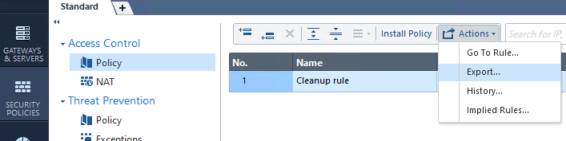
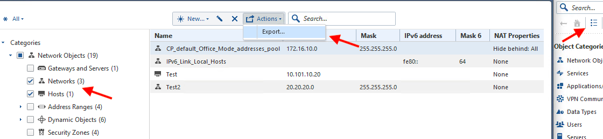

Check Point Conversion
######################

Tested on Check Point SmartConsole **CSV** export files for security policies and network objects.
Note: Because SmartConsole CSV exports lack transport protocol identifiers (TCP vs. UDP), service object conversion from Check Point is currently not supported.

|

File-based Conversion
*********************

Here are the steps to export the required CSV files from Check Point:

**Policies**:

- Log in to SmartConsole and go to **Security Policies**.
- Click **Actions** and select **Export**.

|

**Objects**:

- Log in to SmartConsole. In the right panel, click the options menu (... icon) on the toolbar.
- Select **Networks and Hosts** from the left navigation panel.
- Click **Actions** and select **Export**.

|

Final Step
**********

Go to `After conversion <final.html>`_.
