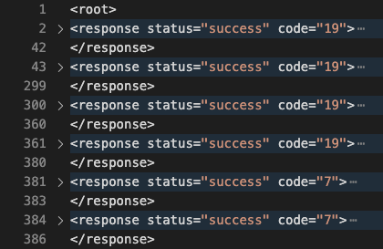

Palo Alto Conversion
####################

Since Palo Alto PAN-OS supports an XML output format, here are the steps for exporting configuration and policy files:

File-based Conversion
*********************

**Policy and Configuration**

- Log in to PAN-OS via the CLI or console.
- Run the command: ``set cli config-output-format xml``.
- Enter configuration mode by running ``configure``.
- Run the ``show`` command.
- Copy the output into a file.
- Supported file extensions are ``.log`` and ``.txt``.
- Because the PAN-OS XML output does not contain a single root element, you must wrap the entire output in ``<root>`` and ``</root>`` tags.

|

Final Step
**********

Go to `After conversion <final.html>`_.
