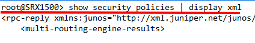
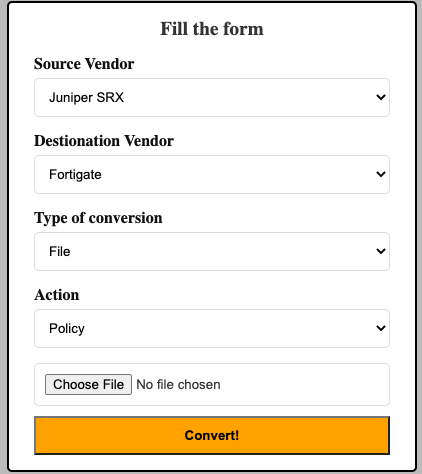
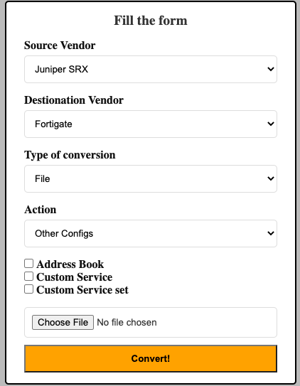
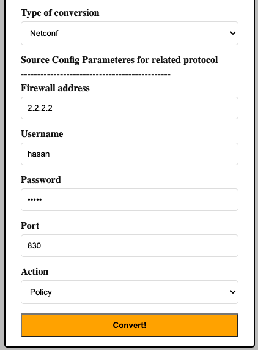

SRX Conversion
##############

Tested on Junos 12.x, 15.x, and 18.x, fwmig uses the XML format to convert configurations and policies.
Security policies cannot be extracted from standard SRX configuration output because it does not preserve **rule order**. Instead, fwmig extracts rules and their order from ``show security policies``.

Features
========
- Address Books (Global and Policy-based)
    - Name
    - Description

- Services and Service Groups
    - Name
    - Description
    - Source and destination ports
    - Session timeout

|

File-based Conversion
*********************

If you want to extract SRX configurations and policies manually, select ``file`` under the ``Type of conversion`` section and follow the steps below:

SRX Configuration and Policy Export
===================================

Here are the steps to export the correct files from an SRX device:

**Policy**:

- Log in to the SRX and run: :code:`show security policies | display xml`
- Copy the output into a file.
- Make sure only XML content is in the file.
- Supported file extensions are ``.log`` and ``.txt``.

**General Configuration**:

- Log in to the SRX and run: :code:`show configuration | display xml`
- Copy the output into a file.
- Make sure only XML content is in the file.
- Supported file extensions are ``.log`` and ``.txt``.

For example, if the file starts or ends with non-XML lines, please remove them. In the figure below, the first line is not XML-formatted:

Important: After conversion, you must apply the configuration files (addresses and services) first. Policies reference these objects, so if they do not already exist on the destination firewall, policy creation will fail.

Using Conversion
================

After following the `SRX Configuration and Policy Export`_ steps, upload your file through the web UI. For policy conversion, select ``policy`` under ``Action`` and upload your XML policy file. If you choose ``other configs``, options for Address Books, Services, and Service Groups will become available. The figures below illustrate both options:

|

NETCONF
*******

You can also use NETCONF for automated retrieval in fwmig. The tool connects directly to the SRX device, retrieves configurations or security policies in XML, and converts them for the destination vendor. Ensure that NETCONF access (port TCP/22 or TCP/830) is enabled on the SRX device. The figure below shows the NETCONF configuration screen:

|

Final Step
**********

Go to `After conversion <final.html>`_.
